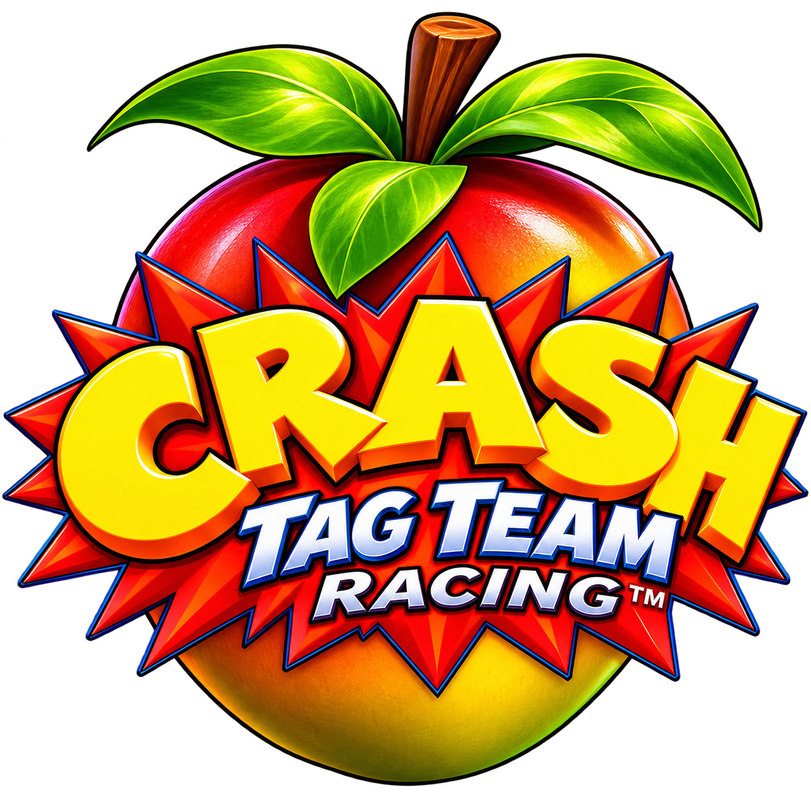

# Crash Tag Team Racing PC

**By NyxBorn**

<a href="https://recomplauncher.com/game/crash-tag-team-racing-pc"><picture><source media="(prefers-color-scheme: dark)" srcset="https://recomplauncher.com/assets/press/launcher/badge-light.svg"></picture></a>
<a href="https://recompstore.com/dev/miguel0827"><picture><source media="(prefers-color-scheme: dark)" srcset="https://recompstore.com/assets/press/verified-light.svg"></picture></a>

**[Download the latest version](https://github.com/Miguel0827/Crash-Tag-Team-Racing-PC/releases/latest)** (Windows `.zip` or Linux `.tar.gz`) · [Report a problem](https://github.com/Miguel0827/Crash-Tag-Team-Racing-PC/issues/new/choose)

| | |
|---|---|
| 🖥️ **Native** | The game's own code runs as a real PC program: no emulator |
| 📺 **16:9 widescreen** | Always on |
| ⚡ **50/60 FPS** | Optional, double the original 25/30 |
| 🎮 **PSP content** | Optional unlock: cars, arenas and co-op |
| 🔍 **Up to 4x resolution** | Lighter menus and title screen, normal CPU use |
| ⏸️ **Quick menu (F1)** | Resolution, picture, vertical sync, keys, quick save/load |
| 🐧 **Windows and Linux** | Installer with a progress bar, desktop shortcut, saves folder |
| 💿 **Your own disc** | Nothing of the game is included: it is converted from your ISO |

Native PC port of *Crash Tag Team Racing* (PlayStation 2) built with [ps2-native-recomp](https://github.com/exoteric33/ps2-native-recomp): the game's own code is translated to C++ and compiled for Windows or Linux **on your PC, from your own disc**. This project contains **no game code, no game data and no disc images**.

*Port nativo para PC de Crash Tag Team Racing (PS2). El juego se convierte en tu PC a partir de tu propia copia. Este proyecto no contiene nada del juego.* (Español abajo.)

## What you need

- **Windows** 10/11 64-bit, or **Linux** 64-bit (see [Linux](#linux)), and an internet connection for the first install (on Windows about 1 GB of tools is downloaded).
- An ISO you made from **your own** Crash Tag Team Racing disc. Supported:
  - **Europe / Australia** — SLES-53439 (English, French, German, Spanish, Italian, Dutch)
  - **USA / Latin America** — SLUS-21191 (English)
- A graphics card with Vulkan (or Direct3D 12 on Windows).

## Use (Windows)

1. Download the Windows zip from the [latest release](https://github.com/Miguel0827/Crash-Tag-Team-Racing-PC/releases/latest) and extract it to a short folder **without spaces and outside OneDrive**, for example `C:\Games\CTTR`.
2. Open **`Crash Tag Team Racing PC - Config.exe`** (installing and settings).
3. Click **Import ISO...** and choose your ISO. The installer downloads the converter, applies this project's fixes and converts the game. It takes several minutes the first time. At the end it offers a desktop shortcut.
4. Choose your settings and press **PLAY**. Once installed, **`Crash Tag Team Racing PC.exe`** appears next to it and goes straight into the game.

In the game, **F1** opens the quick menu (resolution, picture, vertical sync, keys, quick save/load).

## Linux

Download the Linux `.tar.gz` and extract it (`tar xzf ...`). It works like on Windows, with windows (zenity) on a desktop:

1. Install what the build needs, once:
   - Debian / Ubuntu / Mint: `sudo apt install clang libc++-dev libc++abi-dev cmake ninja-build python3 libsdl2-dev git curl unzip pkg-config zenity`
   - Fedora: `sudo dnf install clang libcxx-devel libcxxabi-devel cmake ninja-build python3 SDL2-devel git curl unzip pkgconf zenity`
   - Arch: `sudo pacman -S clang libc++ cmake ninja python sdl2 git curl unzip pkgconf zenity`
2. Run **`linux/config.sh`** (the settings window). The first time it asks for your ISO and installs the game with a progress bar; at the end it offers a desktop shortcut.
3. From then on, **Crash Tag Team Racing** in your applications menu (or `linux/play.sh`) goes straight into the game; **Crash Tag Team Racing - Config** changes the settings.

From a terminal: `./linux/install.sh your-game.iso`, then `./linux/play.sh` (options `--scale 1-4`, `--fps`, `--psp`, `--window`, `--lang 1-6`; see `--help`).

## What this project adds

Fixes to ps2-native-recomp (`patches/cttr-fixes.patch`, made for commit `b1af7232b320`):

- **Freeze after the intro film fixed**: a lost wake-up in the drawing queue on Windows (and messages too large for the queue are split).
- **Vector unit programs no longer recompiled thousands of times**: the game rewrites the LOI constants inside its VU1 microcode every frame; they are now read at run time and ignored when a program is recognised. CPU use drops from ~95 % to normal.
- **Title screen and menus 9x lighter** (`PS2_DMA_TIME`): GIF transfers take the time the console would take (PATH3 waits behind VIF1's geometry), so the game no longer draws the same scene 18 times per frame.
- **Quick menu (F1)** in English and Spanish (accented letters added to the font), in a purple pixel-art style, with a **vertical sync** option. The right stick's left-right comes the right way round by default.
- The game's window carries the game's icon.

The launcher (`tools/Launcher.ps1`) and installer (`tools/Instalar.ps1`) are in English, Spanish, French, German, Italian and Portuguese; the Linux windows (`linux/`) in English and Spanish. The converter is downloaded from this project's own copy ([Miguel0827/ps2-native-recomp](https://github.com/Miguel0827/ps2-native-recomp)), with the original repository as a fallback.

Optional patches from the PCSX2 community (downloaded during install from [PCSX2/pcsx2_patches](https://github.com/PCSX2/pcsx2_patches), not included here): 16:9 widescreen (Arapapa, nemesis2000, PeterDelta), 50/60 FPS (PeterDelta / asasega), PSP content unlock (CRASHARKI).

**ReShade** (optional, Vulkan, Windows) is not included: install it yourself from [reshade.me](https://reshade.me) for `ps2run.exe` if you want SMAA or sharpening.

## Coming next

- **Online races (work in progress):** racing other players over the internet, with quick matches against random players. Each player still needs their own disc of the same version.

## Where things go

Everything stays in this folder: the installer creates **`engine/`** next to `tools/` with the converter, its tools (~1 GB) and your converted games, saves and settings. `engine/` is listed in `.gitignore`; delete it before sharing or uploading this folder.

Your saves: the **`Partidas`** folder next to the programs leads to them (`memcard.ps2` is the memory card, `states` the quick saves); the note inside says which file is which. Importing the ISO again keeps them, and the launcher's **Delete** button asks whether to keep them.

## Troubleshooting

- **"Este disco no es una versión soportada"** (this disc is not a supported version): only the Europe/Australia (SLES-53439) and USA/Latin America (SLUS-21191) discs are supported.
- **"No se pudo descargar el archivo de parches de PCSX2"** (could not download the PCSX2 patch file): the first install needs an internet connection.
- **The installation fails while building**: some of the build tools do not handle spaces in the folder path. Move this folder to a short path without spaces and outside OneDrive (for example `C:\Games\CTTR`) and import the ISO again. Each import starts clean and keeps your saves.
- **The game is slow or the picture tears**: lower **Internal resolution**, switch **Vertical sync**, or try the other **Graphics API** (Vulkan / Direct3D 12).
- **Double FPS or PSP content is greyed out**: the PCSX2 patch file for your disc version has no such patch.
- **Installer log**: `%TEMP%\cttr-pc-install.log` on Windows, `/tmp/cttr-pc-install.log` on Linux. Attach it when you report a problem.

## Do not share

Do not share ISOs, the converted program (`ps2run.exe` and the generated C++), or saves. They contain the game, which belongs to its owners.

## Reporting problems

Only the **official releases** are supported: the [Releases](https://github.com/Miguel0827/Crash-Tag-Team-Racing-PC/releases) page and RecompLauncher. Other branches (such as `multiplayer`) are unfinished work in progress: please do not report problems from them.

[Open a bug report](https://github.com/Miguel0827/Crash-Tag-Team-Racing-PC/issues/new/choose) and say which disc version you have, Windows or Linux, and what graphics card you use. If the installation failed, attach the installer log.

## Credits and licences

- [ps2-native-recomp](https://github.com/exoteric33/ps2-native-recomp) © Samir Nuri and exoteric33, MIT licence. The fixes in `patches/` are under the same licence.
- Launcher, installer and fixes: **NyxBorn**, MIT licence (`LICENSE`).
- Crash Tag Team Racing © Activision / Radical Entertainment. This is an unofficial fan project, not affiliated with or endorsed by them.

---

## Español

**Windows:**

1. Descarga el zip de Windows de la [última versión](https://github.com/Miguel0827/Crash-Tag-Team-Racing-PC/releases/latest) y descomprímelo en una carpeta corta, **sin espacios y fuera de OneDrive**, por ejemplo `C:\Juegos\CTTR`.
2. Abre **`Crash Tag Team Racing PC - Config.exe`** (instalar y configurar).
3. Pulsa **Importar ISO...** y elige la ISO de **tu propio disco** (Europa SLES-53439 o USA/Latinoamérica SLUS-21191). La primera vez tarda varios minutos: descarga el convertidor, aplica los arreglos de este proyecto y convierte el juego. Al terminar ofrece un acceso directo en el escritorio.
4. Elige la configuración y pulsa **JUGAR**. Ya instalado, aparece **`Crash Tag Team Racing PC.exe`**, que abre el juego directamente.

**Linux:** descarga el `.tar.gz`, descomprímelo, instala lo necesario (comando de arriba, sección *Linux*) y abre **`linux/config.sh`**: pide tu ISO, instala el juego con barra de progreso y ofrece un acceso directo. Después el juego aparece en tu menú de aplicaciones como **Crash Tag Team Racing**.

En el juego, **F1** abre el menú rápido. La versión europea trae español; la de USA solo inglés.

Todo queda en esta carpeta: el instalador crea **`engine`** con el convertidor, sus herramientas y tus juegos convertidos, partidas y configuración. Bórrala antes de compartir o subir la carpeta. Tus partidas: la carpeta **`Partidas`**, junto a los programas, lleva a ellas.

**Próximamente:** carreras online contra otros jugadores (en desarrollo), con partidas rápidas contra jugadores al azar. Cada jugador necesitará su propio disco de la misma versión.

**Si algo falla:** si la instalación falla al compilar, mueve la carpeta a una ruta corta sin espacios y vuelve a importar la ISO (tus partidas se conservan). Si el juego va lento, baja la **Resolución interna** o prueba la otra **API gráfica**. El registro de la instalación está en `%TEMP%\cttr-pc-install.log` (Windows) o `/tmp/cttr-pc-install.log` (Linux).

No compartas ISOs ni el juego convertido: contienen el juego, que es de sus dueños.

Solo se aceptan reportes de errores de las **versiones oficiales** (página de [Releases](https://github.com/Miguel0827/Crash-Tag-Team-Racing-PC/releases) y RecompLauncher). Las demás ramas, como `multiplayer`, están en desarrollo y sin terminar: no reportes errores de ellas.

---

### Support my work · Apoya mi trabajo 💜

This port is free and always will be. If you want to support my work as a developer, you can sponsor me on GitHub.
It's completely optional: it doesn't unlock anything and it doesn't pay for the game. You always need your own disc.

*Este port es gratis y siempre lo será. Si quieres apoyar mi trabajo como desarrollador, puedes patrocinarme en GitHub.
Es totalmente opcional: no desbloquea nada y no paga el juego. Siempre necesitas tu propio disco.*

